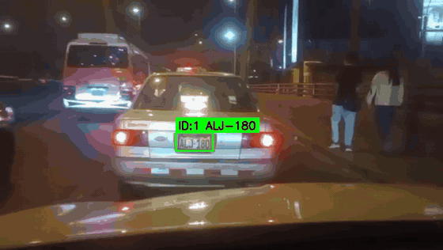
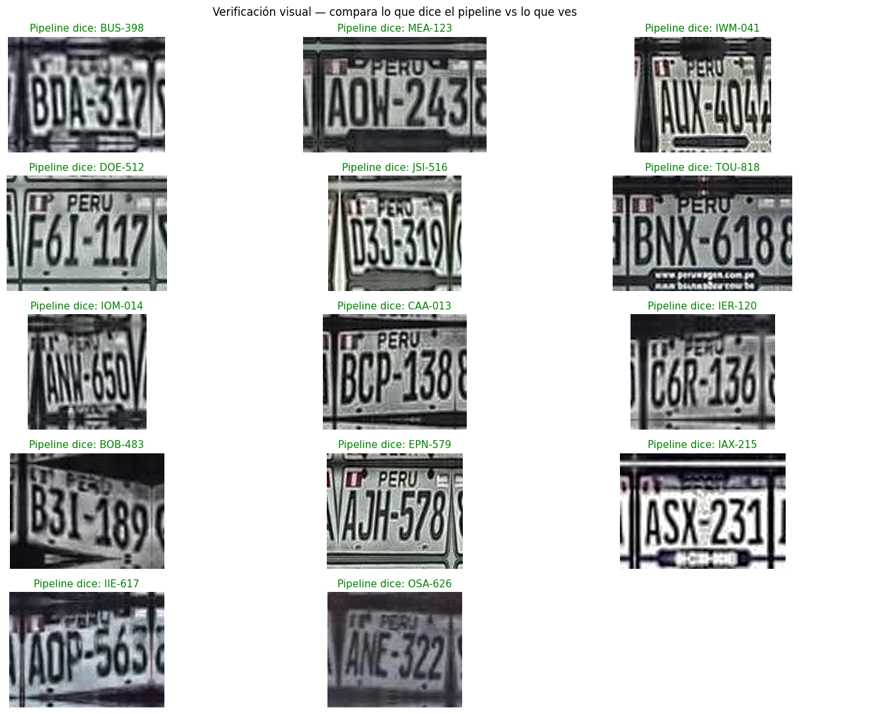
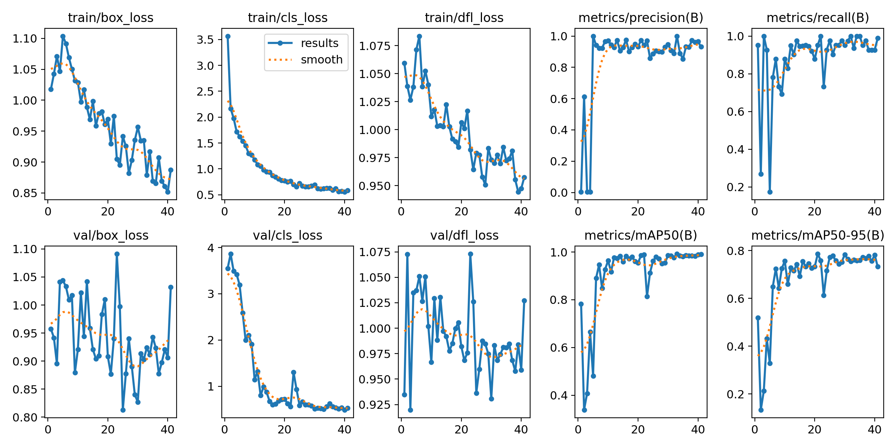
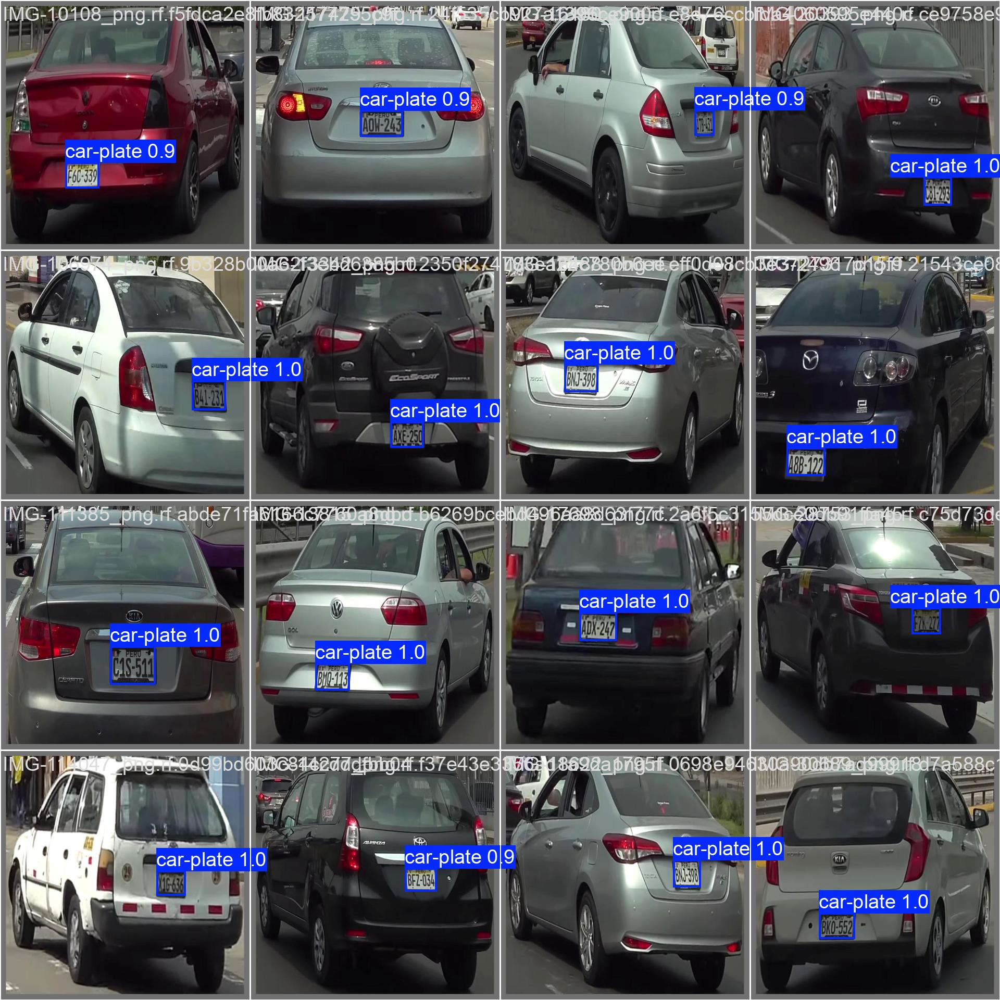

# Lector de placas vehiculares peruanas

Sistema que **detecta placas peruanas con YOLO11** y **las lee con un modelo de visión y lenguaje (Qwen2.5-VL-3B)**. En video, sigue cada placa entre fotogramas y consolida la lectura por votación.

<p align="center">
  
</p>

## Resultados

| Etapa | Métrica | Resultado |
|---|---|---|
| Detección (YOLO11n) | mAP@0.5 en validación (41 imágenes) | **0,986** |
| Detección (YOLO11n) | mAP@0.5:0.95 · precisión · recall | 0,787 · 0,973 · 0,951 |
| Detección en prueba | Placas detectadas en 21 imágenes no vistas | 17 / 21 |
| Lectura con Qwen2.5-VL (prompt afinado) | Lecturas con formato peruano válido (`ABC-123`) | 13 / 21 (76 % de las placas detectadas) |
| Video (214 fotogramas) | Lectura consolidada por votación | `ALJ-180`, correcta (24 de 26 votos) |

## Cómo funciona

```
Imagen o video ─► YOLO11n detecta la placa ─► recorte con margen ─► Qwen2.5-VL lee el texto
                                                                       │
                       En video: seguimiento por placa + consulta cada 5 fotogramas + voto mayoritario
```

1. **Detección.** YOLO11n entrenado sobre el dataset público [Peruvian Plate Detection](https://universe.roboflow.com/tp2-bbjq4/peruvian-plate-detection-rbdtj/dataset/2) (235 imágenes de entrenamiento, 41 de validación y 21 de prueba; licencia MIT). Entrenamiento en Colab con una GPU T4, imágenes de 640 px y *early stopping* con paciencia de 20 épocas.
2. **Lectura.** El recorte de la placa pasa a un modelo de visión y lenguaje con un prompt específico para el formato peruano, y la respuesta se valida con una expresión regular.
3. **Video.** Cada placa recibe un ID de seguimiento. El modelo de lectura se consulta cada 5 fotogramas, y la lectura final es la más votada. Esto filtra los errores de fotogramas aislados (`ALC-160`, `ALB-800`) y deja la lectura estable.

## Lo que aprendí al comparar enfoques de lectura

| Enfoque | Lecturas con formato válido | Observación |
|---|---|---|
| EasyOCR directo | 0 / 21 | No lee bien recortes pequeños y de baja resolución. |
| EasyOCR + preprocesamiento (CLAHE, nitidez) | 0 / 21 | Mejora el contraste, pero no la lectura. |
| EasyOCR + regex + corrección de caracteres | 4 / 21 | La corrección ayuda poco. |
| EasyOCR con varias versiones del recorte | 14 / 21 | **Formato válido, pero en la revisión visual la mayoría era incorrecta**: la corrección "inventaba" placas plausibles. |
| **Qwen2.5-VL con prompt afinado** | **13 / 21** | Más robusto al ruido y a la iluminación, y no inventa lecturas. |

La lección: **una métrica de formato válido no es una métrica de exactitud.** La revisión visual mostró que el mejor número (14/21) escondía lecturas falsas.

<p align="center">
  
</p>

## Entrenamiento

<p align="center">
  
</p>
<p align="center">
  
</p>

## Cómo ejecutarlo

Los notebooks están pensados para Google Colab con GPU:

1. [`notebooks/01_entrenamiento_yolo11.ipynb`](notebooks/01_entrenamiento_yolo11.ipynb): descarga el dataset desde Roboflow (pide tu API key), entrena YOLO11n y evalúa.
2. [`notebooks/02_lectura_placas_vlm.ipynb`](notebooks/02_lectura_placas_vlm.ipynb): compara EasyOCR con Qwen2.5-VL y procesa un video con seguimiento y votación.

```bash
pip install -r requirements.txt
```

## Limitaciones y siguientes pasos

- El conjunto de prueba es pequeño (21 imágenes). Falta medir la **exactitud de lectura** contra etiquetas reales, no solo el formato válido.
- YOLO no detectó 4 de 21 placas: hace falta más datos de placas lejanas, de noche o inclinadas.
- Qwen2.5-VL-3B tarda cerca de 1 s por placa en una T4. Para tiempo real habría que reducir las consultas o usar un modelo de lectura más ligero, ajustado a placas.

---

Proyecto del curso **Redes Neuronales y Aprendizaje Profundo**, Maestría en Inteligencia Artificial – UNI. Autor: [Percy Nazario](https://github.com/PercyTechX) · [LinkedIn](https://www.linkedin.com/in/percy-nazario/)
